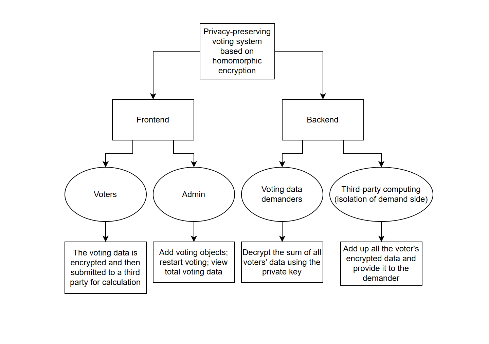
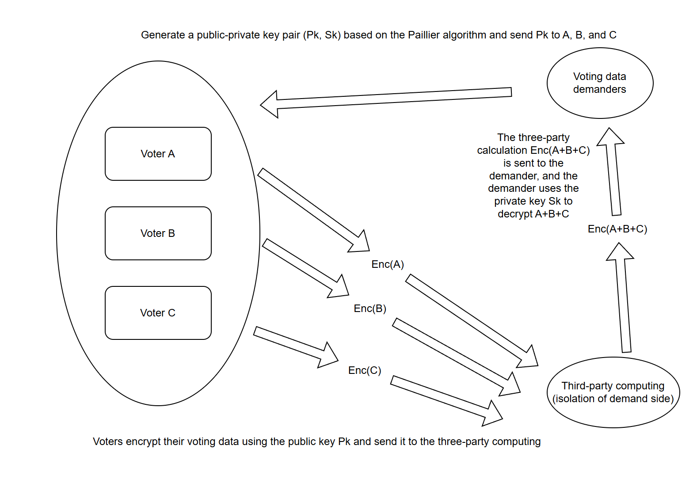

# Privacy-preserving voting system based on homomorphic encryption

<p align="center">
  <a href="./README.md"></a>
  <a href="./README_CN.md"></a>
</p>

## Introduction

This system establishes a privacy-preserving voting platform based on Paillier homomorphic encryption technology, ensuring privacy during the voting process. The system is divided into two parts: the data demander and the third-party computation system. The data demander is responsible for setting and obtaining voting information and obtaining voting results, while the third-party computation system receives encrypted voting information and calculates the voting results. The system uses Paillier homomorphic encryption to encrypt voting information, ensuring privacy during the voting process and effectively preventing vote-buying and attacks by those who coerce voters.

## Framework Diagram



## Cryptographic Security Logic



## Paillier Homomorphic Encryption

**Key Pair Generation**：   

1. Choose two large prime numbers p and q.
2. Compute n = p * q and λ = lcm(p-1, q-1).
3. Choose a random number g such that g has order n.
4. Compute μ = (L(g^λ mod n^2))^(-1) mod n, where L(u) = (u-1)/n.
5. The public key is (n, g) and the private key is (λ, μ).

**Encryption**：

1. Choose a random number r.
2. Compute the ciphertext c = g^m * r^n mod n^2, where m is the plaintext.

**Decryption**：

1. Compute m = L(c^λ mod n^2) * μ mod n.

**Homomorphic Properties**：`E(m1) * E(m2) = E(m1 + m2) mod n^2 Additive Homomorphism`

1. Given two ciphertexts c1 and c2, corresponding to plaintexts m1 and m2.
2. Compute c = c1 * c2 mod n^2, corresponding to plaintext m1 + m2.

## Backend interface documentation

### Data demanders `PORT：5000`

1. **Get the public key**：

- URL: /get_pubkey
- method: GET
- response:

```json
{
    "status": "success",
    "message": "Public key fetched",
    "key": {
        "班干部":[123,123],
        "学习委员":[123,123]
    }
}
```

2. **Delete the voting session (delete key pair, delete voting object information, delete voting results)**:

- URL: /restart
- method: POST
- request:

```json
{
    "vote_obj": "班干部",
}
```

- response:

```json
{
    "status": "success",
    "message": "Restart success"
}
```

Error:

```json
{
    "status": "error",
    "message": "No vote info"
}
```

3. **Set voting information**：

- URL: /set_vote_info
- method: POST
- request:

```json
{
    "vote_obj": "班干部",
    "list": ["teacher1", "teacher2", "teacher3"]
}
```

- response:

```json
{
    "status": "success",
    "message": "Vote info saved"
}
```

4. **Get voting information**：

- URL: /get_vote_info
- method: GET
- response:

```json
{
    "status": "success",
    "message": "Vote info fetched",
    "result":[
        {
            "vote_obj": "班干部",
            "list": ["teacher1", "teacher2", "teacher3"]
        },
        {
            "vote_obj": "学习委员",
            "list": ["student1", "student2", "student3"]
        }
    ]
}
```

Error:

```json
{
    "status": "error",
    "message": "No vote info"
} 
```

5. **Get voting results**：

- URL: /get_vote_result
- method: GET
- response:

The score is the total score. Normally includes voting results.

```json
{
    "status": "success",
    "message": "Vote result fetched",
    "vote_obj":{
        "班干部":{
            "result": {
                "teacher1": 123,
                "teacher2": 123,
                "teacher3": 123
            },
            "vote_people_number":123
        },
        "学习委员":{
            "result": {
                "student1": 123,
                "student2": 123,
                "student3": 123
            },
            "vote_people_number":123
        },
    }
}
```

There is a voting session but no one voted

```json
{
    "status": "success",
    "message": "Vote result fetched",
    "vote_obj":{
        "班干部":{
            "result": "No vote result", 
            "vote_people_number":0
        },
        "学习委员":{
            "result": {
                "student1": 123,
                "student2": 123,
                "student3": 123
            },
            "vote_people_number":123
        },
    }
}
```

6. **Receive encrypted votes**：`Third-party computing interface`

- URL: /receive_vote
- method: POST
- request:

```json
{
    "vote_obj": "班干部",
    "vote_sum":{
        "teacher1":123,
        "teacher2":123,
        "teacher3":123
    },
    "user_sum":["userA","userB"]
}
```

- response:

```json
{
    "status": "success",
    "message": "Vote received"
}
```

### Third-party computing interface `PORT：5001`

1. **Delete the voting session (delete encrypted voting information)**：

- URL: /restart
- method: POST
- request:

```json
{
    "vote_obj": "班干部",
}
```

- response:

```json
{
    "status": "success",
    "message": "Restart success"
}
```

Error:

```json
{
    "status": "error",
    "message": "No vote info"
}
```

2. **Submit encrypted votes**：

- URL: /submit_vote
- method: POST
- request:

```json
{
    "username": "userA",
    "vote_obj": "班干部",
    "vote": {
        "teacher1":123,
        "teacher2":123,
        "teacher3":123
    },
    "pubkey": [123, 123]
}
```

- response:

```json
{
    "status": "success",
    "message": "Vote submitted"
}
```
